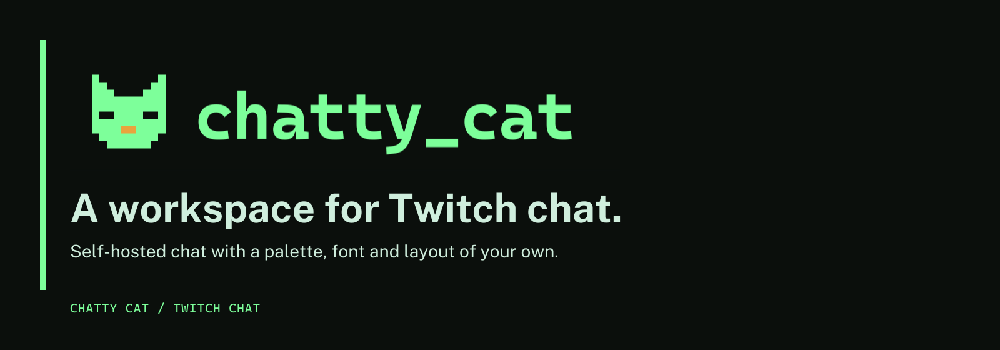

# Chatty Cat



Chatty Cat is a self-hosted Twitch chat client: one Go service with a
TypeScript frontend. It started as a rebuild of
[HasanAbi Chat Thing](https://github.com/mxmilkiib/hasanabi.neocities.org) and
its [Twitch Chat Relay](https://github.com/mxmilkiib/twitch-chat-relay) by
mxmilkiib. The original app is still the reference for many details, but
product decisions now come first.

It runs at [chat.subcult.tv](https://chat.subcult.tv). The rebuild is in
progress; the [parity checklist](docs/parity.md) tracks which feature families
are complete.

## Features

- **Watching chat:** merge up to six channels in one pane or split them into
  independent panes, without signing in. Chatty Cat reconnects to Twitch IRC and
  restores available public backfill.
- **Chatting:** sign in with Twitch to send messages, replies, commands and
  whispers. Whispers stay in their own pane and out of history and stats.
- **Messages:** reply threads, permalinks, user cards with recent messages,
  pronouns, user notes, bookmarks, link previews, VOD context and searchable
  local history.
- **Emotes:** a picker with Twitch, account and third-party emotes and Unicode
  emoji, with filters, recents and animation controls.
- **Moderation:** moderation actions and presets, the AutoMod queue, polls,
  predictions and broadcaster actions for accounts with those permissions.
- **Display:** the original palettes and fonts, custom themes, filters,
  columns, header modes, saved layouts and keyboard shortcuts
  ([docs/keyboard-shortcuts.md](docs/keyboard-shortcuts.md)).
- **Stream video:** an embedded player beside chat.
- **OBS overlay:** `/overlay.html?channel=yourchannel` gives a chat-only
  browser source.
- **Imports and sync:** import Chatterino settings, layouts and commands, and
  sync settings between devices when the server has a sync directory.
- **Optional services:** BTTV and 7TV events and cosmetics, image uploads to
  the server, and a relay to other IRC networks, each off until configured.
- **Desktop app and browser build** for Linux x86-64 and Apple Silicon macOS,
  plus Chromium and Firefox companion extensions. See
  [docs/desktop-app.md](docs/desktop-app.md).

OAuth tokens and sessions stay on the server, in memory; they never enter
browser storage. Restarting the server signs everyone out.

## Quick start

You need Go 1.26+ and Node 22.12+.

```sh
npm --prefix web ci
npm --prefix web run build
go build -o bin/chatthing ./cmd/chatthing
./bin/chatthing
```

Open `http://127.0.0.1:8080`. Anonymous chat works without Twitch credentials.
For sign-in, create a Twitch application, register the callback
`<your origin>/api/auth/callback`, and set `CHATTHING_PUBLIC_URL` to that origin
(loopback HTTP is allowed for local testing).

Tests and checks:

```sh
go test -race -cover ./...
go vet ./...
golangci-lint run
npm --prefix web test
npm --prefix web run build
npm --prefix web run check:overlay   # checks the overlay's JavaScript bundle
```

`GET /api/health` reports that the process is up. `GET /api/ready` returns 503
while shutting down or when the built frontend is missing.

## Configuration

The service reads environment variables, plus an optional env file at
`CHATTHING_ENV_FILE` (default `../.env`; a missing file is allowed). Variables
already set take precedence. Keep the env file out of Git.

| Variable | Purpose |
| --- | --- |
| `CHATTHING_ADDR` | Listen address, default `127.0.0.1:8080` |
| `CHATTHING_ASSETS` | Built frontend directory, default `web/dist` |
| `CHATTHING_PUBLIC_URL` | Public HTTPS origin used for OAuth; loopback HTTP allowed |
| `TWITCH_CLIENT_ID`, `TWITCH_CLIENT_SECRET` | Server-side Twitch application credentials |
| `GIPHY_API_KEY` | Optional browser key for GIF search |
| `CHATTHING_PROVIDER_SERVICES` | Optional BTTV and/or 7TV event services |
| `CHATTHING_COSMETIC_PROVIDERS` | Optional cosmetic badge providers |
| `CHATTHING_SYNC_DIR` | Writable directory that turns on device sync |
| `CHATTHING_UPLOAD_DIR` | Writable directory that turns on image uploads |
| `CHATTHING_IRC_CONFIG` | Path to a JSON list of allowed IRC relay endpoints |
| `CHATTHING_WORKSPACE_CHANNELS`, `CHATTHING_CHAT_SUBSCRIPTIONS` | Channel and subscription limits |

## Deploy

The `Dockerfile` builds one image with the Go service and the built frontend.
`compose.yaml` runs it read-only on host loopback port 8080:

```sh
docker compose --env-file /path/to/private.env up -d --build chat
```

Put an HTTPS reverse proxy in front of it that keeps the Host header and
WebSocket upgrades, or start the included Caddy proxy with
`--profile https` after changing `deploy/Caddyfile` to your domain. Set
`CHATTHING_PUBLIC_URL` to the same origin and register its callback on your
Twitch application. [deploy/README.md](deploy/README.md) has the details.

To build the desktop app or browser build yourself:

```sh
npm --prefix web ci
npm --prefix desktop ci
python3 scripts/build-desktop.py              # desktop app for this machine
python3 scripts/build-chatthing-release.py dist   # browser build archives into dist/
```

## Project layout

```text
cmd/chatthing/   server entry point
internal/        auth, IRC, metadata, previews, provider services, uploads, sync
web/             TypeScript frontend (Vite)
desktop/         Electron shell for the desktop app
companion/       browser companion extensions and the macOS overlay helper
deploy/          Caddy and Compose examples
docs/            architecture, design system, parity and feature notes
scripts/         build, release and data-generation scripts
```

[docs/architecture.md](docs/architecture.md) describes how the parts fit
together. The curated resource content comes from the original app; to refresh
it, run `python3 scripts/port-resources.py /path/to/original/index.html`.

## Contributing

- Report bugs and request features in
  [GitHub issues](https://github.com/subculture-collective/chatty-cat/issues).
- Ask questions and share ideas in
  [GitHub Discussions](https://github.com/subculture-collective/chatty-cat/discussions).
- Send code as a pull request on GitHub against `main`.

CI runs the Go race tests and vet, the frontend tests and build, and builds the
Linux app, macOS app and browser build on every pull request. The
`Mirror CI gate` check must pass before a pull request can merge.

## License

Chatty Cat is licensed under the GNU Affero General Public License v3.0. See
[LICENSE](LICENSE) and [NOTICE.md](NOTICE.md) for attribution. Retained assets
keep their upstream licenses. If you run a modified version for other people
over a network, the license requires you to offer them its source.
