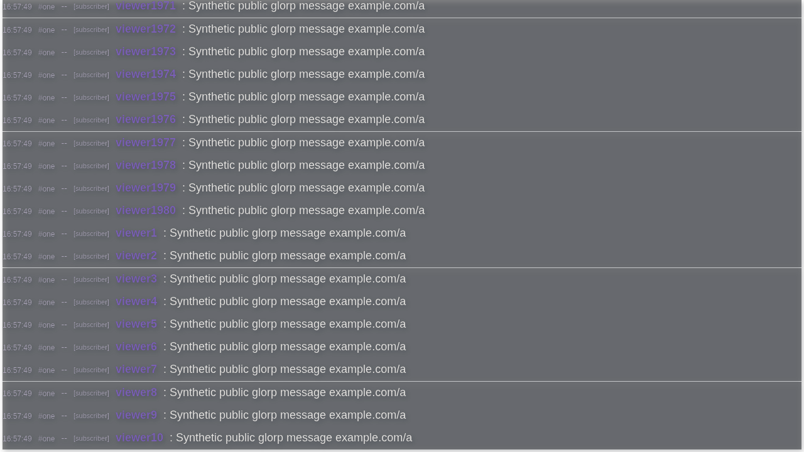

# Wave 5: worker ownership and dedicated overlay

This wave covers #137 and #138. The implementation is prepared from merged main
`e690b02` (PR #171). Production remains on `b95b7fb`; this report does not authorize
or claim deployment of the new branch.

## Persistent statistics and rates

The Window retains its bounded message store and schedules work. A ledger worker
owns observations, replay IDs, unfinished emote reconciliation, counter/bucket
maps, ranks, pruning and snapshot construction/encoding/persistence. Channel
catalogs cross the boundary when their references change. Bootstrap crosses in
chunks of at most 2,000 rows, retaining first-bootstrap semantics until the last
chunk. Incoming message fields/tags are captured when queued.

One event batch runs at a time. Query/save barriers stay between preceding and
following observations. A slow write therefore cannot capture later observations
in an earlier save. The ledger admits 100,000 bootstrap rows plus one metadata
batch; ordinary event queues and query barriers are bounded. Overflow or lost
transport closes observation delivery and blocks saves until reload. Definite
write/quota errors preserve earlier snapshots and permit a later explicit save.
Shutdown drains admitted events, captures a final save and closes the worker.
Abrupt tab/process termination still cannot guarantee a completed save.

The rate worker owns live/replay rules, source coverage, socket/page/timer gaps,
rolling samples, peak selection, comparison computation and rate snapshots. The
header only renders returned samples; hidden/detached headers do not request
painting. Comparison invalidation/account/privacy checks remain in the Window.
The picker receives compact cached gap metadata from acknowledged event batches.
Worker loss shows an unavailable rate header instead of computing on the Window.
The existing database names, versions, raw ledger JSON and rate snapshot formats
remain readable by the previous release.

Retained-row Stats reports also transfer at most 2,000 messages per request. The
facade captures the array of row references before yielding, so incoming rows and
scrollback eviction cannot change the chunk boundaries of an in-flight report.
The worker accumulates that one bounded report and returns the unchanged summary.
The Stats panel keeps its coalescing and stale-filter/close protections while
awaiting ledger, rate and summary queries.

The no-IndexedDB compatibility branch now builds/encodes its ledger snapshot in
the worker and returns the bounded raw string for the Window's localStorage write.
Explicit reviewed legacy migration, recovery copies, private-journal receipts,
archive policy handshakes and provider authorization remain unchanged.

## Dedicated overlay

`/overlay.html?channel=one,two` has its own Vite entry. Legacy root URLs containing
`overlay` with a value other than `0` receive a temporary same-origin redirect,
preserving the complete raw query. Fragments remain browser navigation state.
The normal root and `overlay=0` keep the full application.

The overlay mounts only public transport, one metadata read per channel, an
in-memory bounded message store, a virtual log and passive appearance runtimes.
It loads no account/session API, private conversations, shell, panels, storage
worker or repeating/storage clocks. It does not hydrate or save public history.
Transport retry/deadline timers can still run when disconnected; rendering is
scheduled only by messages, sizing, visibility or preference changes.

The passive row renderer keeps native/provider emotes, zero-width stacking,
badges, subscriber months, Unicode/text, timestamps, replies as text, public
notices, moderation removal and visibility filters. It has no message action
buttons, composer, interactive link cards or picker/catalog UI. Text/Unicode are
rendered as native text; it does not load the emoji reference catalog. Saved
public display/presentation/theme preferences are read in that browser-source
profile. Background opacity, foreground opacity and content shadow keep their
existing overlay-only semantics.

The build enforces the complete statically imported JavaScript closure for both
entries, including shared chunks. CSS is reported separately. An overlay closure
at or above one quarter of main fails the build; a deliberate incompressible
20 KiB addition was rejected. This guard is the overlay part of #138. Wave 6
still owns broader main/lazy/data transfer budgets under #141.

## Verification and boundaries

See the [JSON receipt](wave5-local-evidence-2026-10-18.json) for exact artifacts, tests and runtime observations.
The busy-session fixture emits synthetic public messages at 100 messages/second
without credentials or upstream/provider transport. Its public API and emitted
build exercise the real Window/worker/IndexedDB paths. The readout reports overall
long tasks separately from guarded storage paths and worker dispatch durations.
It does not turn a rendering long task into a storage success claim or provide
CPU/GPU attribution automatically. Row-cache size is unavailable to the external
observer and is recorded as null.

Native OBS checks use a temporary profile/scene and an authenticated isolated
Xvnc display, with Mesa software rendering and browser hardware acceleration off.
Browser-source renderer CPU is separate from the OBS compositor's process CPU.
These checks do not establish production GPU use, live provider behavior,
production deployment or a production-origin OBS profile's appearance.

The final local suite passes 924 tests in 190 files, strict TypeScript, formatting,
Go race tests and Go vet. Merged main `e690b02` passed both hosted push checks;
that result does not cover this branch. Local bundle measurements use Node gzip
level 9 per emitted file: main 149,765 bytes and overlay 26,764 bytes (17.87%),
counting shared imports. CSS is 14,863 and 10,712 gzip bytes respectively and is
reported separately from the JavaScript gate.

The native OBS source capture below uses synthetic public traffic. In a separate
30-second idle observation, both renderer processes accumulated zero measured CPU
time, with zero DOM mutations, intervals, workers or database opens. OBS's own
reported CPU averaged 2.272% with the idle overlay and 0.719% with the source
hidden and shut down (a 1.553 percentage-point difference). The software compositor
therefore does not establish #138's near-zero total OBS CPU gate. On October 18 the owner accepted the renderer-specific idle result for #138.
Hardware-accelerated qualification is no longer a closure prerequisite; total OBS
CPU remains a separate, unqualified result.

The temporary OBS profile, scene, isolated display and preview listener were
stopped after observation. Production data, browser-source profiles and scenes
were not changed. The existing production rollback guard passed read-only.

## Reproduce the bounded rehearsal

Build with `npm --prefix web run build`, then run
`go run ./web/test-support/wave5-fixture` from the repository root. Use a fresh
browser origin/profile at
`http://localhost:5198/?channel=one&video=off&scrollback=100000&font=system&eonly=0`.
Open Stats, allow a retained-message warmup, and evaluate
`web/test-support/wave5-observe.js` in that tab. It records exactly one 15-minute
observation in `window.__wave`; wait for `complete: true` before reading the final
snapshot. It does not accelerate time. Stop the fixture afterward.

For an idle overlay, use `/overlay.html?channel=idle&font=system` on that fixture.
The fixture has no credentials, upstream transports or provider write handlers.
Its `/fixture/state` counters describe cumulative fixture traffic across clients,
not the message count of one tab. Timers and synchronous callback durations in
the resource readout are cumulative; compare initial and final values. Async
callback work and general rendering stacks need separate attribution.

## Completed 15-minute busy observation

The final artifact ran for 900,121 ms, starting with 60,940 retained messages and
ending at the 100,000-message cap, with Stats open and 45 virtual rows mounted.
The synthetic source targeted 100 messages/second. Both repeating scheduler pools
remained active. Window storage/encoding guards recorded zero attempts, errors
were empty, and the maximum synchronous worker dispatch was 2.2 ms, with no
dispatch over 50 ms. The session dispatched 30 ledger saves and 30 rate saves.
Synchronous storage-scheduler callbacks accumulated 134.9 ms across the session.

The overall long-task observer recorded 8,708 tasks, totaling 857,320 ms with a
202 ms maximum. This is a substantial unresolved full-app performance limitation
at this fixture load. The readout does not capture complete async/rendering
stacks, so these receipts cannot establish the absence of every storage-attributed
long task. #137 stays open for that attribution review; worker ownership and
bounded transport are implemented and tested. The owner accepted #138’s renderer-specific idle gate on October 18; #138 awaits
PR #172 merge. #137 remains open. The roadmap advances implementation to Wave 6 while retaining
these acceptance gates.
